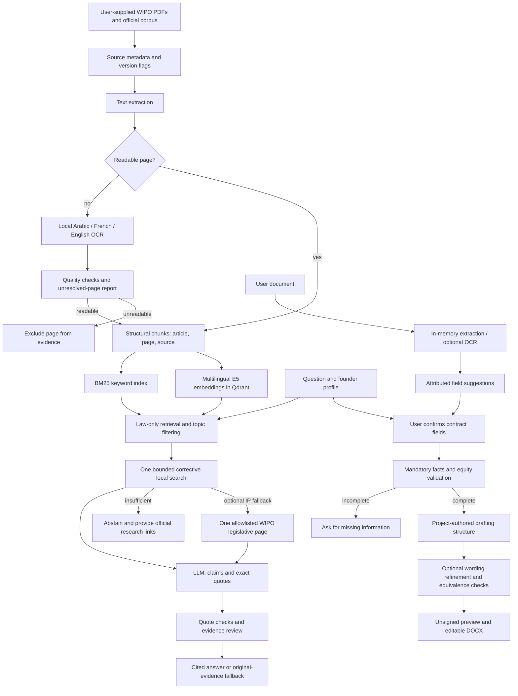

# Legal agent architecture

Shared `/api/chat` routes to the existing `legal` agent. Structured `legal_contract` input produces an artifact that the composer preserves. The dedicated `/legal.html` interface also calls the legal API directly. User uploads are not added to the authoritative evidence corpus.
